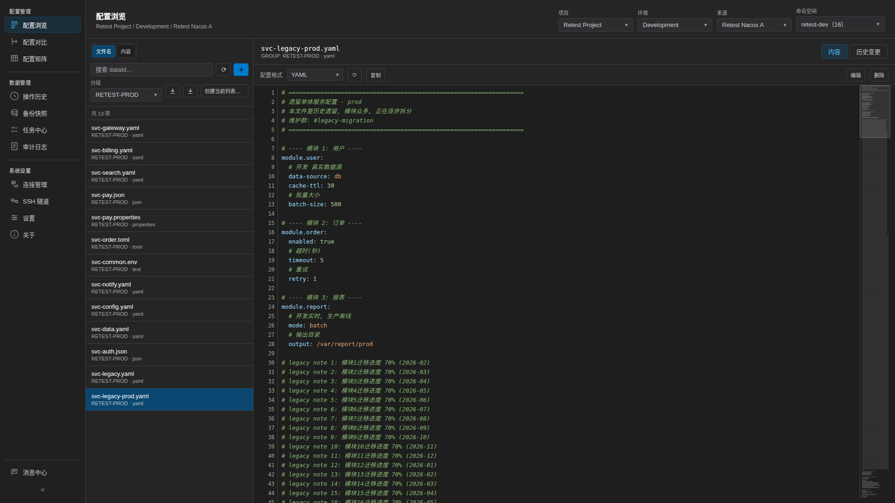
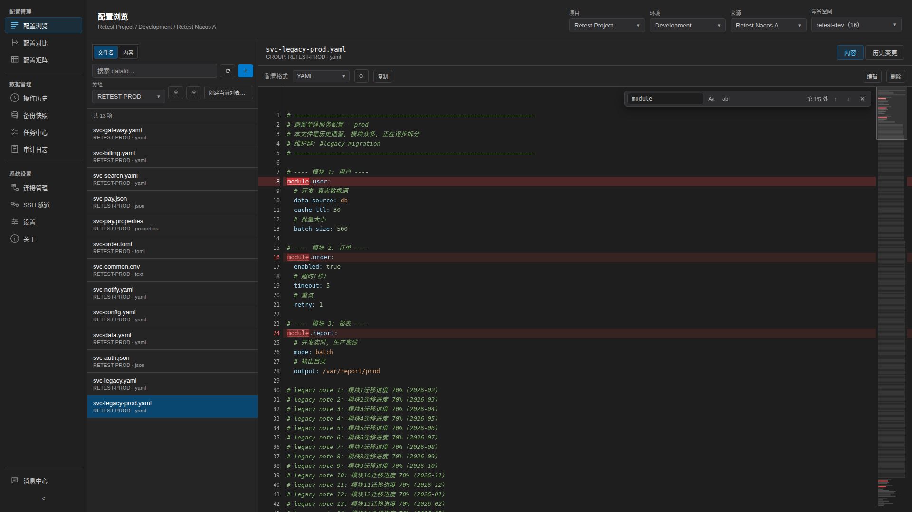
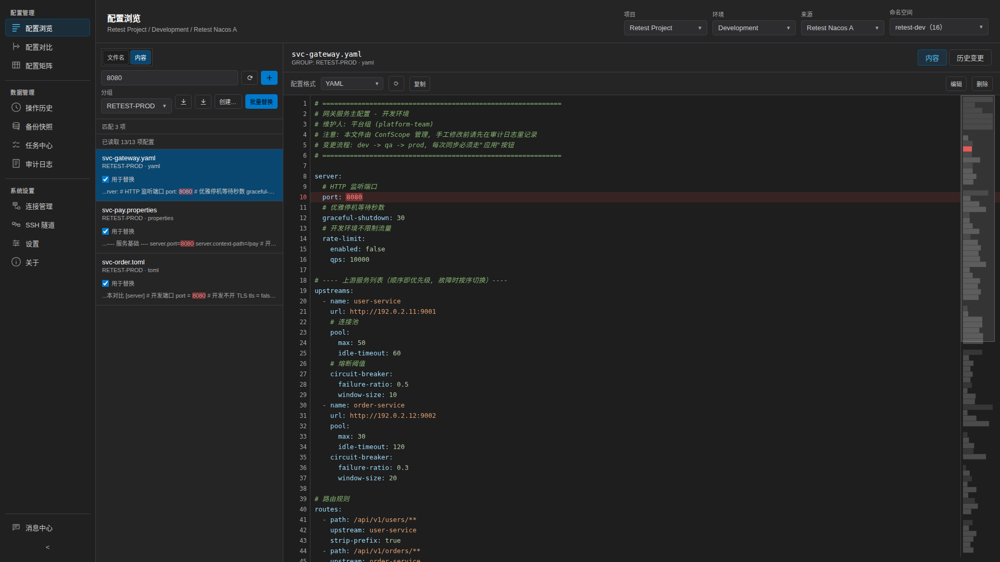
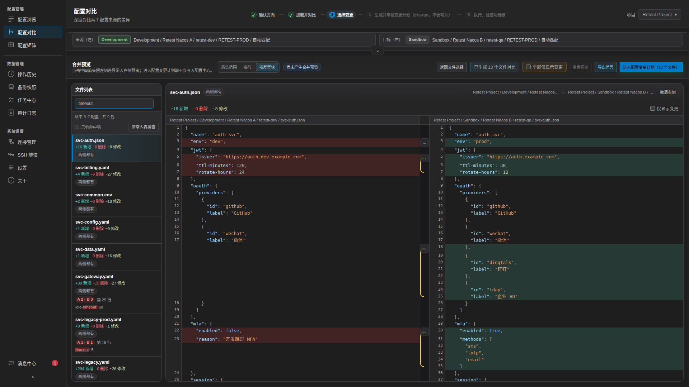
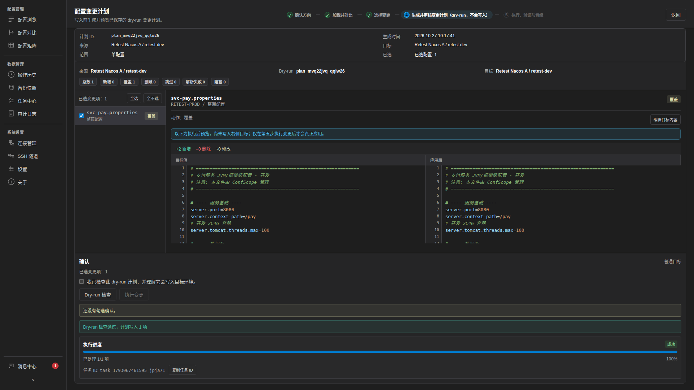
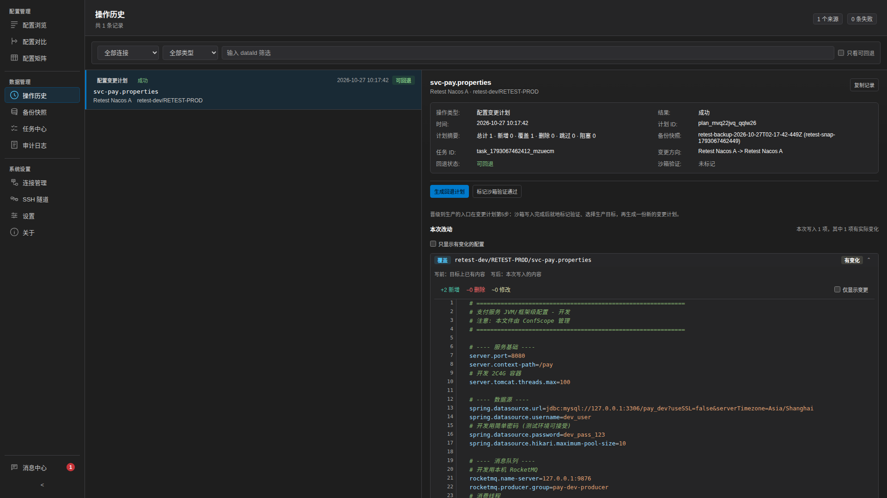
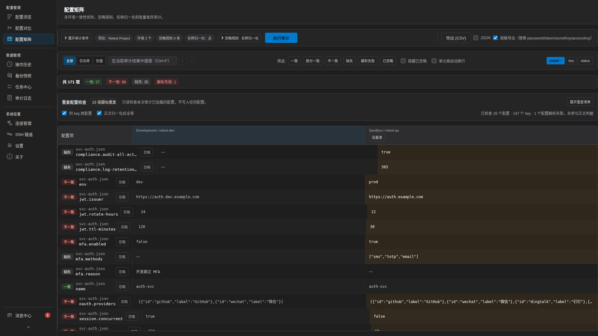

<p align="center">
  
</p>

<h1 align="center">ConfScope</h1>

<p align="center">
  <strong>多配置中心统一管理 · 智能对比 · 安全变更 · 治理洞察</strong>
</p>

<p align="center">
  <a href="https://github.com/Adsryen/ConfScope/releases">下载</a> ·
  <a href="CHANGELOG.md">更新日志</a> ·
  <a href="#界面预览">界面预览</a> ·
  <a href="#开发与构建">开发与构建</a>
</p>

ConfScope 是一个基于 **Wails 2 + Go + React + TypeScript** 的桌面配置中心管理工具，支持 Nacos
（自建与阿里云 MSE）、Apollo、Consul 以及本地/WebDAV 快照来源，覆盖配置浏览、差异对比、一致性
审计、备份恢复与安全变更计划。

它要解决的不是「能不能改配置」，而是这三件更容易出事的事：改之前两份配置到底差在哪、改之后
写进去的还是不是我看到的那份、改砸了从哪儿退回去。

## 界面预览

截图由 `tests/retest/shots/` 从本地 Docker 里的合成配置自动生成（数据来源见
[`scripts/retest-data/README.md`](scripts/retest-data/README.md)），不含任何真实环境信息；
界面改版后重跑一次取证脚本即可对齐，不需要人手截。

### 配置浏览：行号、语法高亮与右侧缩略图

左侧按命名空间/分组浏览配置项，右侧正文带行号与语法高亮，最右侧是类编辑器的缩略图，长文件
靠它定位比拖滚动条快。

<p align="center">
  
</p>

### 配置浏览：`Ctrl+F` 就地查找

在正文里按 `Ctrl+F` 直接开查找栏，支持区分大小写与全词匹配；命中词标红，当前命中所在整行高亮，
缩略图上同步标出命中位置，栏内给出「第 n/N 处」计数与上下条切换。

<p align="center">
  
</p>

### 配置浏览：跨配置内容搜索

切到「内容」模式后按正文搜索整个命名空间，左侧列出每个命中配置及其命中片段（命中词标红），
右侧正文里的命中同样标红并高亮所在行；命中项可勾选后进入批量替换。

<p align="center">
  
</p>

### 配置对比：批量差异与跨项内容搜索

变更走五步：**确认方向 → 加载并对比 → 选择变更 → 生成并审核变更计划（dry-run，不会写入） →
执行与验证**。文件列表支持按内容搜索，命中处数按左右两侧分别计数（如 `A 2 · B 3`）并标出
所在行，点一下就能跳到那一行。左右两侧各自独立选择文本，复制其中一侧不会把另一侧一起带走。

第三步右上角还有「微调右侧」：机器挑不准的部分（内网地址、密码、命名空间、开关默认值）点开是一份
全屏弹窗编辑器（带行号与文内查找），在弹窗里手写成最终要接收的内容，保存即收起弹窗并以此文本进入变更计划，
这一项同时带「人工微调」徽标标出含人工干预。没写完就取消、按 `Esc` 或点弹窗外的遮罩都只收起弹窗，
字迹留在原处，重新打开还是同一份。

<p align="center">
  
</p>

### 变更计划：第 4 步审核与确认

dry-run 跑完才有这一屏：左边勾选要写入的项，右边逐条给出「目标值 → 应用后」的差异预览，下方确认区
写明已选几项、还差哪一步（未勾选、目标被阻断都会逐条列出来）。生产目标还需要手敲确认文本，旁边备
复制键。执行前所有变更都能在这里看清楚，看不到差异就不会落笔。

机器判定不准的项可以点「编辑目标内容」，同样在弹窗里手写这份最终要写出去的内容，`Ctrl+S` 就是
「保存并重新校验」：校验没过弹窗不关，错误逐条列在弹窗里；保存成功才收起，条目上留一枚「未保存的手改」
标记，入口按钮变成「继续编辑」。

<p align="center">
  
</p>

### 操作历史：改了什么、能不能退

每条写入记录都带写前备份快照。点开一条就能看到「本次改动」：逐项列出改过的配置位置与实际变化数，
展开即是写前写后的差异；回退状态与原因直接写在详情里，「生成回退计划」把已写入的项变成一份新的
变更计划，仍要走 dry-run 与确认，不会直接改线上。

<p align="center">
  
</p>

### 配置矩阵：多环境一致性审计

多环境一致性矩阵、忽略规则、名称归一化和批量差异审计，支持按状态筛选、排序与脱敏导出。

<p align="center">
  
</p>

## 支持的配置中心

| 配置中心 | 状态 | 当前能力 |
| --- | --- | --- |
| Nacos | 已支持 | v1/v3 自适配，自建 Nacos 与阿里云 MSE；浏览、内容搜索、版本级历史、Diff、审计、受控写入与删除、ApplyPlan |
| Apollo | 已支持 | OpenAPI 适配；连接测试、浏览、Diff、审计、导出；通过 ApplyPlan 受控写入 properties namespace 并 release |
| Consul | 已支持 | KV 适配；连接测试、浏览、Diff、审计、导出；通过 ApplyPlan 受控创建、更新、删除文本 KV，并用 ModifyIndex/CAS 防护 |
| 本地快照 | 已支持 | 本地目录只读 provider，可参与浏览、Diff、审计与回滚来源 |
| WebDAV 快照 | 已支持 | 配置快照 `.cssnapshot` 上传、远端列表、导入、Diff |

> 所有写入都必须经过 ApplyPlan、dry-run、before 快照与生产目标确认；直接 publish/delete 的绑定
> 会被阻断，本地快照始终只读。
>
> 历史能力分两档说清楚。服务端版本历史只有 Nacos（含 MSE 的 Nacos 兼容协议）拿得到，
> Apollo/Consul/本地快照不显示点不动的「服务端历史」；但自 1.9.8 起程序自行留存**本机版本历史**，
> 任何 provider 都能在历史页看到本机见过的各个版本，本机那一版在目标可写时给出回滚入口。
> 命名空间级的中心历史目前所有 provider 都拿不到，操作历史页就不发这个请求。

## 核心特性

| 模块 | 说明 |
| --- | --- |
| 连接与来源管理 | 按项目、环境、来源管理多套配置中心连接；Nacos/Apollo/Consul/本地快照统一入口 |
| 配置浏览 | 命名空间、Apollo App/Cluster/Namespace、Consul KV prefix、本地快照目录统一浏览；行号、语法高亮、缩略图、`Ctrl+F` 就地查找与命中定位；就地编辑期间服务端把同一份配置改了内容时不静默覆盖你的文字，提示后可选「改用服务端最新内容」或「继续用我的改动」；服务端正文这次没取到也不收起编辑器，草稿照旧可改、可用「复制草稿」抄走，重新载入成功之前不给生成变更计划 |
| 内容搜索 | 跨配置按正文搜索，命中片段与处数一并给出，命中项可勾选进入批量替换 |
| 差异对比 | 单文件与批量对比、行级与键级差异、按差异块跳转、跨项内容搜索与 A/B 分侧命中计数、第三步人工微调右侧目标内容（手写值带「人工微调」徽标进计划）、导出差异 |
| 配置矩阵审计 | 多环境/多来源一致性矩阵、忽略规则、名称归一化、差异定位、CSV/JSON 脱敏导出；另有只读的跨配置重复检查（同一个 key 出现在多个配置、正文归一化后全等两条规则，忽略清单支持 `*` 通配，勾两个位置可送去对比或生成回退计划） |
| 版本历史 | 服务端历史与本机历史并列展示，两边都可达时才出现切换分段；程序读到正文记一版、写入并回读确认再记一版，回滚仍走变更计划五步审核；单条正文超限只留摘要与字节数并如实标注；保留策略为最早一版锚点加最近 N 版，N 在设置页的「每配置保留版数」里可调，某一版可以单独「钉住」让清理永不删它（正文相同的行一起保住），调小上限后点「按新上限清理」立刻腾出磁盘；设置页可见其体量与落点并可单独清除 |
| 安全变更计划 | ApplyPlan dry-run、before 备份、受保护目标强确认、沙箱验证与回滚链路；受保护目标按连接与环境的名称识别，执行前必须手敲确认文本，名字里没有「生产」这类标记时当场提醒再确认一次；程序不替你判定哪一套环境算生产，要把改动落到别的环境，就从配置浏览或配置对比正常发起一份计划、把那一套环境选成目标，五步审核与强确认照常生效；浏览页的新建、编辑覆盖、删除与历史回滚也统一物化成变更计划入口，没有绕过 dry-run 的直写路径 |
| 执行安全 | 执行前最后一刻复检目标内容指纹，线上被别人改过就中止而不是覆盖；写入前校验阿里云 MSE 的 AK/SK，缺凭据就地报错而不是匿名写出去吃 403；写入后逐项回读，报出「已确认 / 有漂移 / 读不到」三态，半截失败也回读已写入的部分；失败记录仍带写前快照，可据此构造回退入口；半截写入（前面几条已生效、后面失败）在失败面板直接放出这个入口，回退与沙箱验证的范围按这一次真正覆盖到的位置收口，不拿完整计划当作用范围；同一面板另有「跳过这一项，继续剩下的」，摘掉失败项把剩下的写完，前面已经写成的不会被重复写入；目标已经是这一版的项自动跳过，不写入、不进本次备份，勾选项全部已达成时如实说明「没有需要写入的内容」，也不记操作历史；执行结果的「已应用 N 项」按真正写成的条数计，与同一次操作历史里的「本次写入」一致；被配置中心拒绝时报错说得出下一步——权限类拒绝讲清楚该为这个账号开哪一项权限（写入被拒说写入、读取被拒说读取），服务端没接受这次写入时点名是哪一个配置没写成（位置到命名空间/分组/配置名），错误里的请求地址不带 Nacos 会话令牌，可以放心复制 |
| 操作历史 | 点开一条成功记录就地看到「本次改动」：逐项列出写前与写后的差异，汇总「本次写入 N 项，其中 M 项有实际变化」并可只看有变化的配置，不必先生成一份回退计划；逐条说明能不能回退、不能回退缺了哪一环，可回退的直接生成回退计划，「只看可回退」筛选会被记住；沙箱验证状态（标在哪套环境的哪个命名空间、什么时间）也在这一屏 |
| 留痕与消息 | 会话审计日志 `audit-trail.jsonl` 记录对比、审计与执行三类会话的全过程；长任务的完成与失败汇总进消息中心，即时提示只出现在窗口右下角并在几秒后自动收起，程序自己发现的事只亮未读角标、不打断当前操作 |
| 备份恢复 | 应用数据 `.csbackup` 本地/WebDAV 备份恢复；配置快照 `.cssnapshot` 本地/WebDAV 同步 |
| SSH 隧道 | 可复用 SSH profile，覆盖 SSH 连接测试与 Nacos over SSH；拨号前校验服务器的主机密钥——第一次连接某台主机时确认算法与指纹并记在本机，之后再连不再询问，指纹与记录不一致直接拒绝连接、认证信息不会发出去，也没有任何跳过校验的放行入口；本机记录与 OpenSSH `known_hosts` 共用同一份写法（非默认端口记作 `[主机]:端口`） |
| 凭据安全 | 连接口令与 SSH 私钥、passphrase 这类大凭据都存进操作系统的凭据库（Windows 凭据管理器 / macOS 钥匙串 / Linux Secret Service，私钥在 Windows 落为只对你这个登录用户生效的加密文件），主数据文件里只存 `secretRef`；设置页「系统凭据库」一处可把本机已有的明文凭据迁入并如实报出迁移结果；备份包仍支持跨机器迁移 |
| 数据位置 | 数据根按运行形态解析（便携版随程序目录走，安装版落系统用户数据目录），设置页展示命中档位与各类数据落点，并支持换根迁移与回退 |
| 应用更新 | 应用内检查更新，更新说明与 GitHub Release 正文同源（都取自 CHANGELOG 同一段落）；Windows 安装版不再卡在「等待 ConfScope 退出」：等不到退出就把正在运行的那一份让到一边、新版本照常装到原位置，旧副本在下次启动时自动清理，全程不强杀进程 |
| 反馈通道 | 关于页「反馈问题」打开 Issue 时预填问题描述、复现步骤、期望表现三段，并自动带上版本号、平台、运行形态、安装包名与界面语言；环境块就地可见可复制，不用手抄 |
| 界面 | 中文/英文文案，环境名推断出统一色调档（dev/test/staging/canary/prod/local），键盘可达性与读屏语义持续收敛 |
| 真实环境测试 | Docker Nacos/Apollo/Consul/WebDAV/SSH fixture + Windows native Wails smoke 覆盖主流程 |

## 数据与凭据边界

- 主数据落在 `[数据根]/app-data/confscope-data.json`：Go 侧原子写并读回校验，文件损坏时隔离为
  `.corrupt-<时间戳>` 并回退浏览器缓存重新水合，不会静默覆盖。浏览器 localStorage 只是热缓存。
- 数据根由一条五档解析链决定，顺序固定：`CONFSCOPE_DATA_DIR` 显式覆盖 → 应用内选定的位置 →
  安装包写入的 `install.json` 标记（安装态落系统用户数据目录）→ 采纳已有数据的旧根（老便携用户
  零迁移）→ 按可写性兜底（exe 目录可写则随程序走，只读目录则落系统用户数据目录）。便携 zip 不带
  安装标记，行为与今天完全一致。
- 设置页「数据位置」展示当前运行形态、命中档位与判定依据，以及主数据、缓存、快照、备份、日志、
  审计各自的落点；可以在这里换数据根：先预览将复制几项多大，确认后复制并逐项校验、最后才写位置
  指针，旧根原样保留不删（只落 `MIGRATED-` 标记），换根或回退都需重启一次应用才全量生效。
- 会话审计日志在 `[数据根]/audit-trail.jsonl`，「清理缓存」只清缓存并从主数据文件重新水合，
  不修改数据文件。
- 本机版本历史在 `[数据根]/app-data/config-revisions.jsonl`：只追加不改历史，换数据根时整目录跟着走；
  读不出来时如实报错，只有「文件确实不存在」才当空历史，压缩与合并拿不到可信结果时拒绝重写。
- `.csbackup` 是换电脑的主路径：备份包加密，恢复时写回可用的本地数据；包密码一次性输入，不持久化。
- Windows 小凭据迁移覆盖 Nacos password/token、阿里云 MSE AK/SK、Apollo token、Consul token、
  WebDAV password。
- SSH private key、SSH passphrase 等大 secret 尚未迁移到安全存储，拆在后续
  `windows-large-secret-protection` 任务线。
- macOS Keychain 与 Linux Secret Service 尚未实现，非 Windows 平台走兼容回退。
- 关于页「反馈问题」带出去的运行环境信息只有版本号、平台、运行形态、安装包名与界面语言，不含数据目录路径、
  连接名、命名空间与配置内容；正文与剪贴板都只在用户明确点击时才动。
- 本 README 的界面截图全部由 `tests/retest/shots/` 用合成数据集重拍产出，不含任何真实环境内容；
  公开截图与文档面的凭据形态由 `tests/ux/publicScreenshotsStaySanitized.test.ts` 在发布预检里
  把住。早期版本 tag 树里遗留的真实环境截图（已按泄露处理）见
  [公开截图凭据暴露面处置记录](docs/security/public-screenshot-exposure-2026-10.md)。

## 技术栈

- Wails v2.13 + Go 1.25（后端直连各配置中心 OpenAPI / HTTP API）
- React 18 + TypeScript 5 + Vite 5
- 主数据文档由 Go 侧原子写 + 读回校验，前端经 `src/lib/appDataDoc.ts` 水合与 debounce 推送
- 测试：Vitest（单测 + 静态守卫 + 数据兼容护栏）、Playwright（e2e / retest 真机回归 / Docker smoke）、
  Go test

## 快速开始

### 环境要求

- Node.js 20（CI 用 20）
- pnpm 10（`package.json` 的 `packageManager` 为准）
- Go 1.25 及以上
- Wails CLI v2.13（`go install github.com/wailsapp/wails/v2/cmd/wails@v2.13.0`）
- Linux 桌面构建需要 `libwebkit2gtk-4.1-dev`、`libgtk-3-dev`
- Docker（跑真实环境回归与 smoke 时需要）

### 安装

```bash
git clone https://github.com/Adsryen/ConfScope.git
cd ConfScope

pnpm install
wails doctor
```

### 开发与构建

Windows：

```powershell
pnpm dev              # scripts/dev-portable-data.ps1：先备份便携数据目录，再注入 CONFSCOPE_DATA_DIR 起 wails dev
pnpm build:win        # NSIS 安装包
scripts\build-latest.ps1              # 一键：依赖 + 前端构建（含生产守卫）+ wails build
scripts\build-latest.ps1 -SkipFrontend  # 只改了 Go 侧时快速重编
scripts\build-latest.ps1 -Launch        # 构建后直接启动
scripts\build-latest.ps1 -ForceClean    # 删掉 node_modules 重装（跨系统构建后链接损坏时用）
```

Linux / WSL：

```bash
CONFSCOPE_DATA_DIR=$PWD/portable/ConfScopeData pnpm dev:plain   # wails dev
pnpm build                                                       # 当前平台桌面应用
bash scripts/build-latest.sh                                     # 同上的一键链路
bash scripts/build-latest.sh --skip-frontend                     # 只改了 Go 侧
bash scripts/build-latest.sh --clean                             # Windows 侧构建过、本侧链接损坏时重建
```

`pnpm dev:web` 只起 Vite（`:1420`），没有 Go 绑定，仅供 UI 调试与真实环境回归使用。

> Windows 与 WSL 若共用同一个 `node_modules`，跨系统构建后另一侧的原生链接可能损坏，
> 报错时用对应侧的 clean 参数（`-ForceClean` / `--clean`）重建。
>
> 生产 bundle 里出现测试脚手架字符串会让 `pnpm build:web` 直接失败（`scripts/check-production-bundle.mjs`），
> 这是刻意设的闸门，不要绕过。

### 测试

```bash
go test ./... -count=1
pnpm typecheck                  # 两遍 tsc：src（基准 tsconfig）+ tests/ 与 scripts/（tsconfig.tests.json）
pnpm lint                       # eslint src/ tests/ scripts/（用例与脚本同样要过，轮85 起）
pnpm test                       # Vitest：src 单测 + tests/ux 静态守卫 + tests/compat 数据护栏
pnpm build:web                  # 前端构建 + 生产 bundle 守卫

pnpm test:e2e                   # Playwright e2e
npx playwright test -c tests/retest/playwright.config.ts   # retest：双 Nacos + SSH 真机回归
pnpm test:smoke                 # Docker 全量冒烟
pnpm test:smoke:native          # Windows native Wails 冒烟

npx playwright test -c tests/retest/shots/playwright.config.ts  # 重拍本文件顶部截图（产物在 shots/out/）
```

retest 与截图取证都依赖 `scripts/retest-data/` 的合成数据，跑之前先按
[`scripts/retest-data/README.md`](scripts/retest-data/README.md) 起好容器，
再跑一次 `python3 scripts/retest-data/init-namespaces.py` 把双 Nacos 需要的命名空间建齐（幂等，
创建后回读确认，并复核 A 侧没有 `retest-qa`）。这一步不能省：往不存在的命名空间发布，Nacos v1
会当成成功（POST 返回 true、blur 列表看得见这一行），但那套租户在命名空间列表里永远列不出来，
应用的浏览页因此读不到它；而 `retest-qa` 在 A 上必须**不存在**——这批用例的命名空间候选与
取数集合是按「每侧一套租户」写死的，A 上多出同名租户读数就对不上，`init-namespaces.py` 会当场拦下来。

全量批也进了 GitHub Actions：`Retest` 作业（手动 dispatch，可选 `--grep` 调试口子），
双 Nacos 与命名空间都由仓库里的脚本拉起，用来兜住「本机环境恰好是好的」这条依靠。

改动**操作历史 / 变更计划第5步 / 分段控件**这类跨页 UI，收口必须跑一次**全量** retest
（不带 spec 参数的那条命令），只跑相关的那几个文件不算：静态守卫与 jsdom 单测挡得住
「代码写回旧设计」，挡不住「真机用例停在旧设计」——撤除写后晋级入口那一批，
`93-matrix-history` / `98-remaining` 两条用例红了一个多星期没人撞见，就是因为全量批不在任何门禁里。

## 发布产物与下载

从 [Releases](https://github.com/Adsryen/ConfScope/releases) 下载对应平台的产物，
版本变更见 [CHANGELOG.md](CHANGELOG.md)。

推送 `v*` tag 后，Release workflow 会先跑门禁（类型检查、静态守卫、Go vet/test、版本注入证据、
发布前校验），再构建并上传：

| 平台 | 产物 | 形态 |
| --- | --- | --- |
| Windows amd64 | `confscope-windows-amd64-installer.exe` | **安装版（推荐）**：每用户 NSIS，装到 `%LOCALAPPDATA%\Programs\ConfScope`，免管理员权限，控制面板可卸载 |
| Windows amd64 | `confscope-windows-amd64-portable.exe` | 便携版：单文件放哪跑哪，数据默认落在 exe 同级 `ConfScopeData` |
| Linux amd64 | `confscope-linux-amd64.tar.gz` / `confscope-linux-amd64.deb` / `confscope-linux-amd64.rpm` | 裸二进制 / 系统包 |
| macOS arm64 | `confscope-macos-arm64.dmg` | 挂载后拖进 Applications |
| macOS amd64 | `confscope-macos-amd64.dmg` | 同上 |

两种 Windows 形态只差**数据根默认落在哪**（见上文「数据与凭据边界」），配置与凭据的写法完全相同：
安装版由安装程序在 exe 同级写 `install.json` 标记，数据落系统用户数据目录；便携版没有标记，数据随
exe 走。从便携版换到安装版不会丢数据——解析链先采纳已有数据的旧根，设置页里也能显式换根迁移。

升级也按形态分流（**程序永不替换自己的二进制**，这一步永远交给人或安装程序）：

- 安装版：关于页「下载并安装 v{x.y.z}」→ 下载 → 按 `update.json` 里的 sha256 校验（不过就中止）→
  起安装程序并优雅退出；安装程序有界等待旧进程退出后覆盖同一位置，不强杀、不碰数据；
- 便携版与 Linux 裸二进制 / tar.gz：下载完成后「打开所在文件夹」，由你把新文件覆盖旧文件；
- `.deb` / `.rpm`：界面给出对应安装命令与复制按钮，由你在终端执行（程序不提权、也不代跑）；
- macOS：下载 dmg 后挂载，由你把 App 拖进 Applications。

Release 正文由 CHANGELOG 对应版本段落渲染（`scripts/sync-github-release-notes.mjs`），与应用内
「检查更新」看到的说明同源。也可在 Actions 里用 **workflow_dispatch** 手动试跑构建（只上传
artifact，不创建正式 Release）。

> macOS DMG 未做 Apple 代码签名与公证。首次打开被 Gatekeeper 拦下时，在 Finder 里对应用
> 「右键 → 打开」确认一次。

## 项目结构

```text
ConfScope/
├── main.go                          # Wails 入口
├── internal/                        # Go 后端模块
│   ├── nacos/ apollo/ consul/       # 各配置中心 API 适配
│   ├── provider/                    # provider 统一抽象与能力口径
│   ├── app/                         # Wails 绑定与应用服务：主数据文档、数据位置、审计写入
│   ├── audit/                       # 会话审计日志（audit-trail.jsonl）
│   ├── export/                      # CSV/JSON 导出与脱敏
│   ├── appbackup/ snapshotwebdav/   # .csbackup 加密备份 / .cssnapshot WebDAV 同步
│   ├── securestore/                 # Windows 凭据库封装
│   ├── portabledata/                # 数据根五档解析链与换根迁移（唯一事实源）
│   ├── ssh/                         # SSH 连接与隧道
│   ├── task/                        # 长任务与进度
│   └── updatecheck/                 # 应用内检查更新
├── src/
│   ├── api/                         # 前端 Wails 绑定 wrapper
│   ├── components/                  # 页面与组件（浏览器、对比、矩阵、变更计划、设置等）
│   ├── lib/                         # Diff、ApplyPlan、执行安全、内容搜索、数据文档等领域逻辑
│   ├── store/                       # 前端状态与缓存
│   ├── locales/                     # 中英文文案
│   └── styles.css                   # 样式
├── scripts/
│   ├── build-latest.sh / .ps1       # 一键出包
│   ├── dev-portable-data.ps1        # Windows 开发启动（便携数据目录 + 先备份）
│   ├── check-production-bundle.mjs  # 生产 bundle 守卫
│   ├── changelogSection.mjs         # 发布说明唯一解析出口
│   ├── sync-github-release-notes.mjs# CHANGELOG → GitHub Release 正文
│   ├── verify-release-version.sh    # 发布前闸门
│   └── retest-data/                 # 合成数据生成与发布
├── tests/
│   ├── compat/                      # 数据迁移兼容护栏
│   ├── ux/                          # 静态守卫与交互契约
│   ├── retest/                      # 真机回归（specs/）与 README 截图取证（shots/）
│   ├── e2e/                         # Playwright e2e
│   ├── smoke/                       # Docker 与 native 冒烟
│   └── fixtures/                    # 测试夹具
├── wailsjs/                         # Wails 生成的前端绑定
└── docs/todo/                       # 路线图与阶段计划
```

## 当前路线图

已完成：

- Nacos v1/v3 支持、配置浏览、版本级历史、Diff、审计
- Apollo OpenAPI 浏览、审计与 ApplyPlan properties 写入
- Consul KV 浏览、审计与 ApplyPlan CAS 写入
- 本地快照 provider、`.csbackup` / `.cssnapshot` 备份与 WebDAV 同步
- ApplyPlan 安全写入、沙箱验证、回滚，以及执行前指纹复检与写后回读
- 主数据迁出 localStorage、便携数据目录与数据迁移护栏
- 配置矩阵一致性审计、忽略规则、名称归一化与脱敏导出
- 会话审计日志与消息中心
- 操作历史逐项写前/写后差异与就地回退入口，沙箱验证状态就地标记与查看
- 浏览器的行号、命中词标红与整行高亮、缩略图、`Ctrl+F` 就地查找
- 批量对比的跨项内容搜索与 A/B 分侧命中计数、命中定位
- 历史入口按 provider 能力收口
- 本机版本历史：不依赖中间件与云产品，读到正文与写后回读确认各自留版，历史页并列两档来源
- Windows 小凭据 `secretRef` 真实迁移
- 应用内检查更新，且 Release 正文与 CHANGELOG 同源
- 容器化全量 smoke 与 Windows native Wails smoke

后续规划：

- Windows 大 secret 保护：SSH privateKey/passphrase/password 的 DPAPI 文件方案
- v2 平台化数据模型：项目、环境、provider、source 抽象
- 多 provider 聚合浏览视图
- 跨 provider 治理矩阵与治理报告
- 平台安全模型
- 跨 provider Apply 策略

详细路线见 [platform-governance-roadmap.md](docs/todo/platform-governance-roadmap.md)。

## 致谢与说明

本项目基于 [Configuration-Center-Browser](https://github.com/iGuos/Configuration-Center-Browser)
的设计思路进行二次开发。原项目提供了 Nacos 配置管理的核心理念和前端交互设计，在此向原作者
[iGuos](https://github.com/iGuos) 表示感谢。

主要改进：

- 后端从纯前端请求重构为 Go + Wails 2 架构。
- 前端扩展为桌面端多页面工作台，覆盖浏览、Diff、审计、备份、任务、设置和 SSH。
- 配置中心从 Nacos 扩展到 Apollo、Consul 和本地快照。
- 引入 ApplyPlan、安全备份、真实环境 smoke 和 Windows 凭据库迁移。

也感谢 [Linux Do](https://linux.do) 佬友开发社区。

## 贡献

欢迎提交 Issue 和 Pull Request。

## 许可证

AGPL-3.0-only

---

<p align="center">
  <br/>
  <strong>ConfScope</strong> — <em>多配置中心统一管理 · 智能对比 · 安全变更 · 治理洞察</em>
</p>
